# InterviewPilot

Paste a job description and get a complete interview preparation kit: the role's requirements, tailored questions with answer outlines, a coverage map, a study schedule, flashcards and a practice mode.

**Live demo:** https://interview-pilot-ten.vercel.app

> The API runs on a free hosting plan that sleeps when idle. The first request after a quiet period can take up to a minute while the server wakes up; the app shows a "waking up the server" notice and retries automatically.

## Screenshots

| | |
| --- | --- |
| 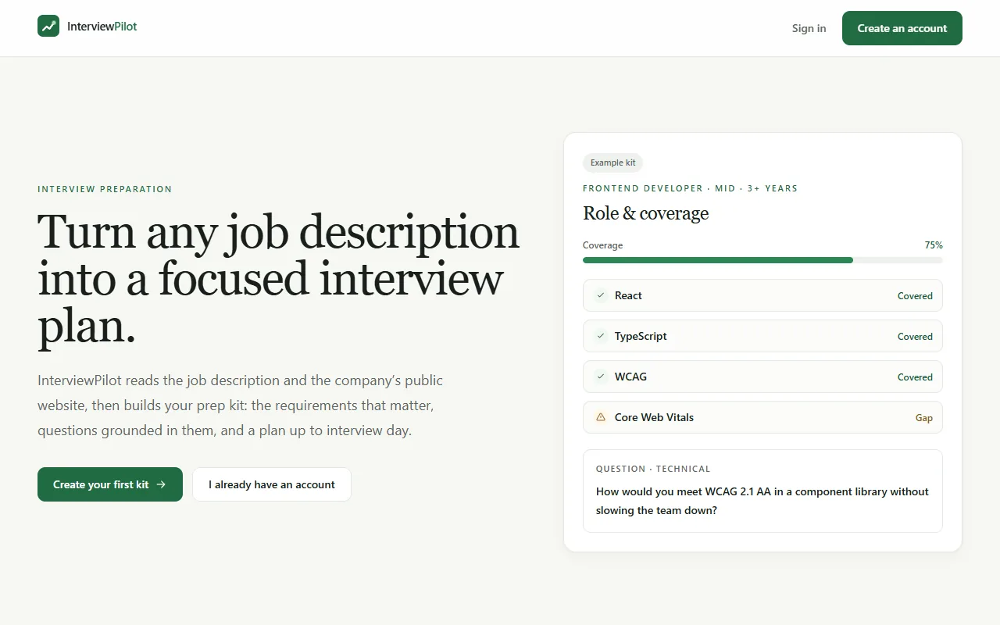 | 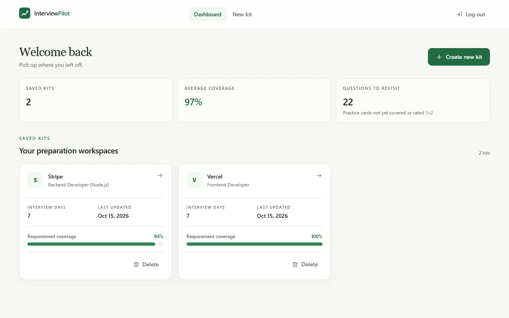 |
| Landing page | Dashboard |
| 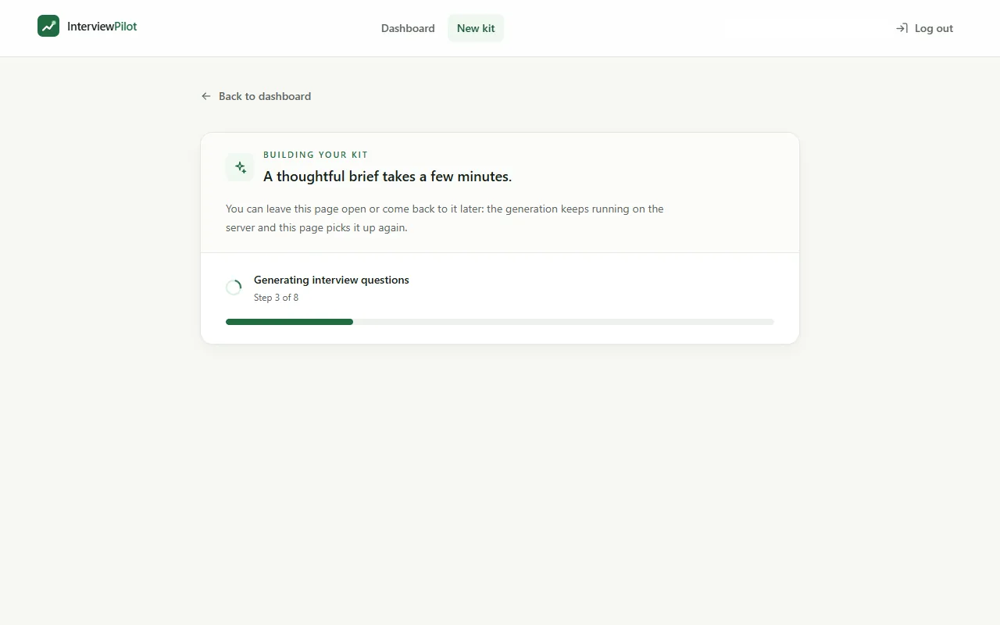 | 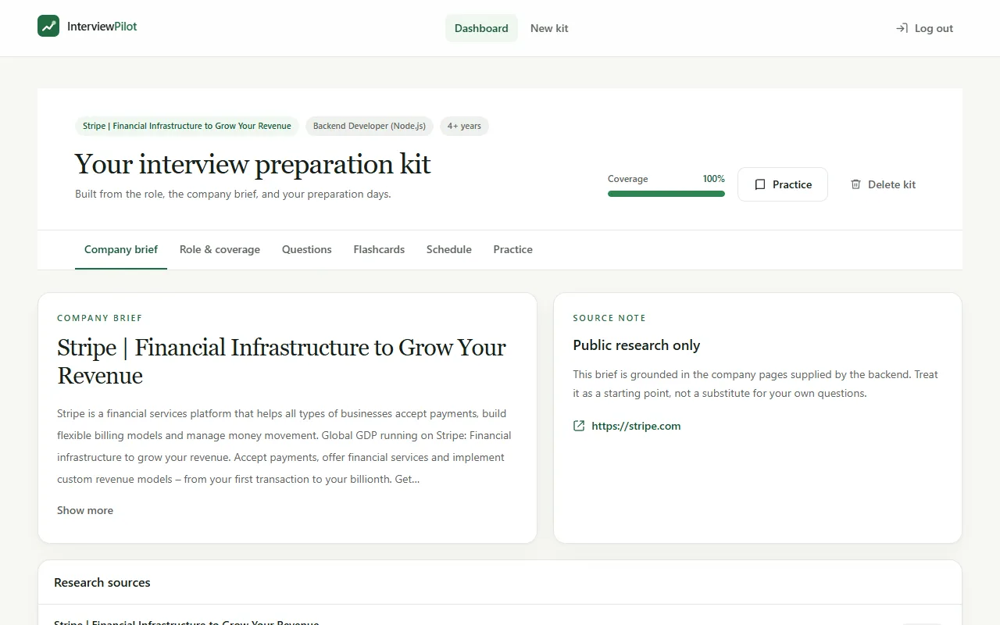 |
| Kit generation progress | Company brief |
| 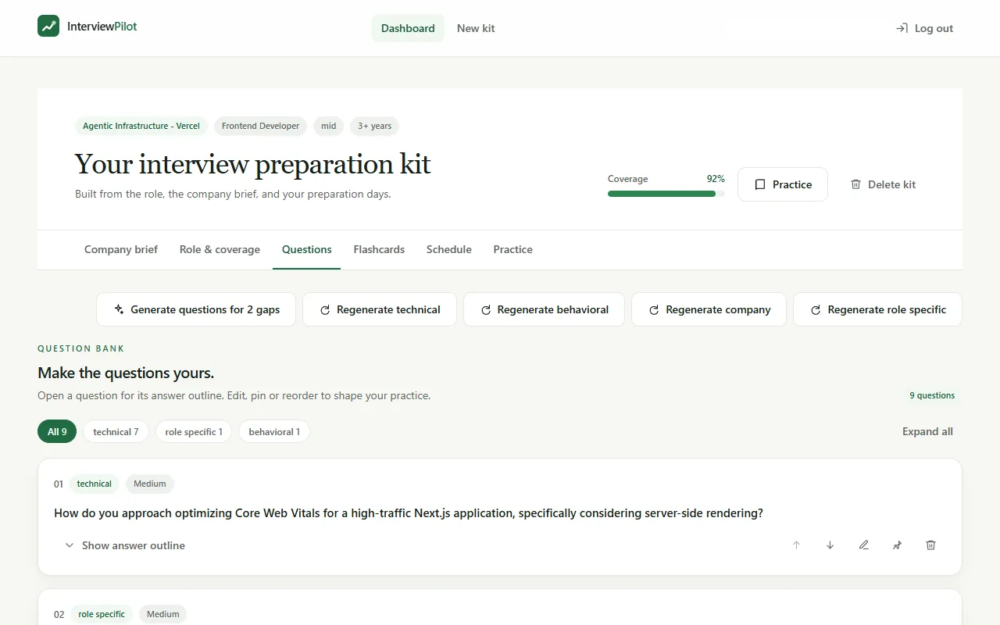 | 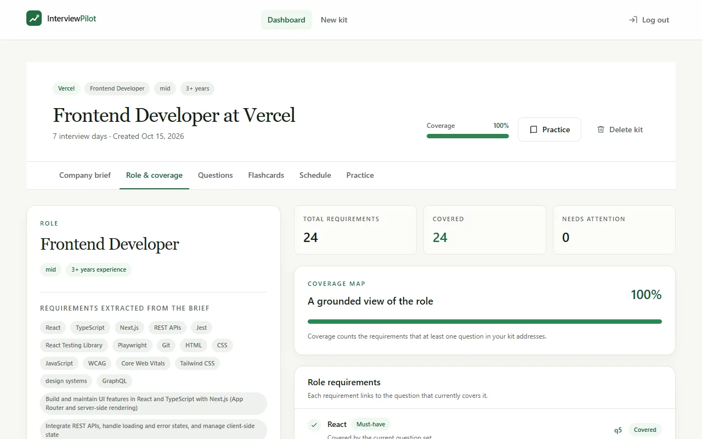 |
| Question bank | Coverage map |
| 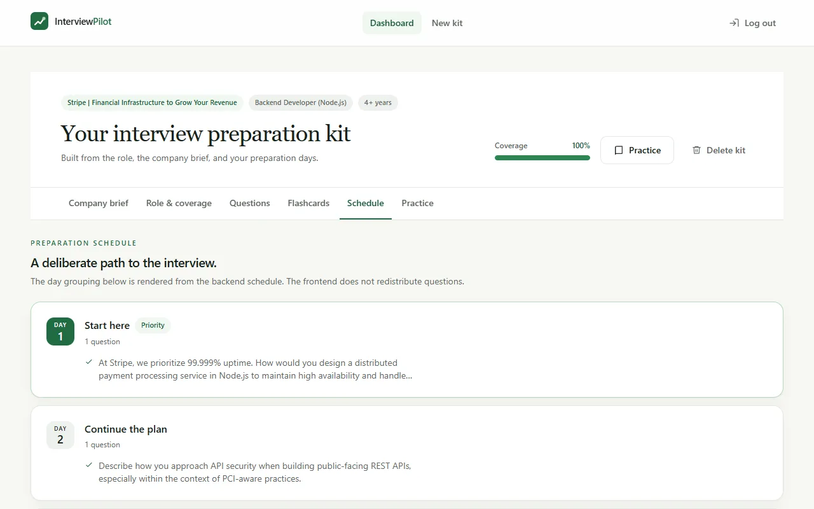 | 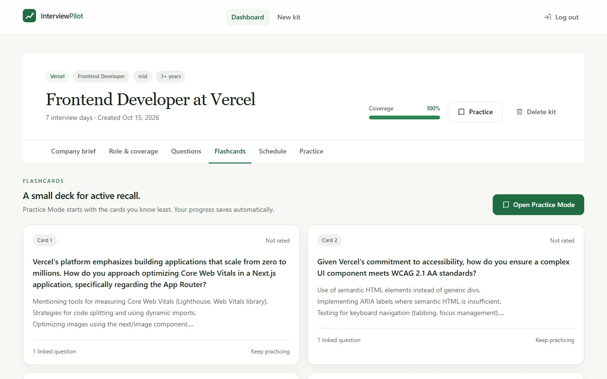 |
| Schedule | Flashcards |
| 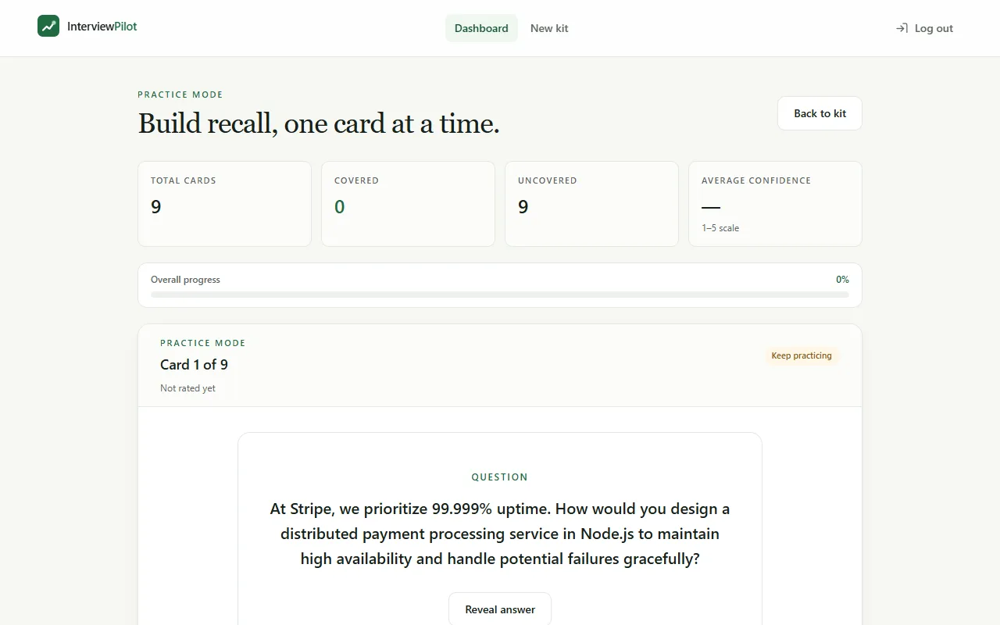 | |
| Practice mode | |

<p>
  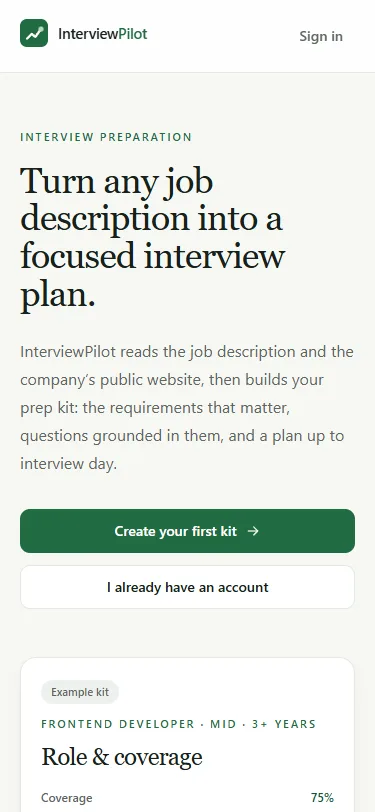
  &nbsp;
  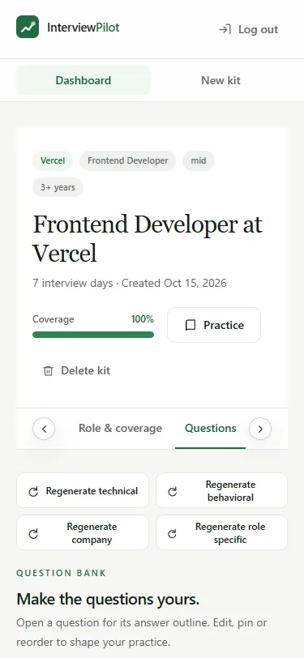
</p>

## Features

- **Job description → kit.** Paste a JD, the role and the company URL; the kit is generated in the background and the page shows each step as it runs.
- **Requirements.** Every named technology, tool and standard becomes its own requirement, split into must-have, nice-to-have, responsibilities and qualifications. Title, seniority and years of experience are kept as role metadata, not requirements.
- **Questions.** Technical, behavioral, company and role-specific questions with answer outlines. Questions can be edited, pinned, reordered, deleted, or regenerated per category.
- **Coverage map.** Which question covers which requirement, computed on the server from the final question set. Uncovered requirements stay visible, and one click generates questions for them.
- **Company brief.** A short summary built from public pages of the company's website.
- **Schedule.** A day-by-day plan across the number of days until the interview (1–60).
- **Flashcards and practice.** A flashcard deck linked to the questions, and a practice mode that saves a 1–5 confidence rating and a covered flag per card and can reorder cards by priority.
- **Resume match (optional).** Attach a PDF or text resume to classify each requirement as matched, partial or missing, with evidence quoted from the resume, and to get questions about your own projects.

## How it works

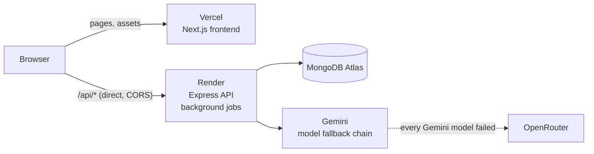

The browser loads the Next.js app from Vercel and calls the Express API on Render directly (not through a proxy), so per-IP rate limits see the real client. Creating a kit returns `202 { jobId }` at once. A background job then runs the pipeline (requirement extraction → company research → question generation → coverage check → gap filling → final coverage check → schedule, plus the resume stages when a resume is attached), and the frontend polls the job until the kit is saved.

## Engineering highlights

- **Async, checkpointed generation jobs with auto-resume.** Each finished pipeline stage stores its validated output as a checkpoint on the job document in MongoDB. When a stage still fails transiently after the whole model chain, the job goes to `retrying`, waits (20 s, then 60 s by default) and resumes from its checkpoints, skipping finished stages. On startup, unfinished jobs are requeued from their checkpoints. A failed job with checkpoints can also be resumed by the user. Jobs have a concurrency cap and a timeout, and finished jobs expire after 7 days (TTL index).
- **Retry/backoff, model fallback chain and cooldown.** Transient LLM errors (timeouts, 429, 499, 503, 504, network resets) are retried with exponential backoff and full jitter, honoring `Retry-After`. After a model's retries are used up, the adapter moves down the chain: the configured Gemini model, then the Gemini fallback models, then OpenRouter as the last fallback (when a key is set). A model that answered 503/504/499 is skipped for a cooldown period. Permanent errors such as an invalid key are surfaced at once instead of being hidden behind another model.
- **Server-side validation of AI output.** Gemini is called with structured output (a JSON response schema), but the schema is a convenience, not the authority: every stage parses and validates the answer itself. Output that is empty, not JSON, fails validation or leaves nothing usable after filtering moves on to the next model. The complete kit passes a structure validator before it is saved, and coverage is always recomputed on the server (client-sent coverage is ignored).
- **Named-tool safety net.** A curated list of well-known technologies and standards (with aliases such as RTL → React Testing Library and CWV → Core Web Vitals) is matched against the JD. A named tool that no extracted requirement stands for is added deterministically, so a model that skips "WCAG" or "Playwright" does not drop it from the kit.
- **Rate limiting, CORS, helmet and least-privilege DB access.** `express-rate-limit` budgets for auth, job creation (per user), job polling (per user) and a per-IP baseline, with `429 RATE_LIMITED` and `Retry-After`. CORS allows only the configured frontend origin(s), `helmet` sets the security headers, and `trust proxy` is configurable so limits key on the real client IP behind Render. The API is built to run with a database user that has only `readWrite` on its own database (startup recovery and index creation work without admin rights), as set up in [`DEPLOYMENT.md`](DEPLOYMENT.md).
- **Evaluation CLI.** `npm run evaluate` runs a batch of JD cases through the same pipeline as the web API (without MongoDB), validates every kit and writes a JSON report with a safe per-case error shape. Saved cases live in [`backend/scripts/cases`](backend/scripts/cases).

## Tech stack

Versions as declared in the `package.json` files.

| Area | Stack |
| --- | --- |
| Frontend | Next.js 14.2.30 (App Router), React 18.3.1, Tailwind CSS 3.4.17 |
| Backend | Node.js (20+; 24 in production), Express ^5.2.1, Mongoose ^9.10.2 |
| AI | `@google/genai` ^2.24.0 (Gemini), `openai` ^7.23.0 (OpenRouter fallback) |
| Security | helmet ^8.3.0, cors ^2.8.6, express-rate-limit ^8.7.1, bcryptjs ^3.0.3, jsonwebtoken ^9.0.3 |
| Hosting | Vercel (frontend), Render (API), MongoDB Atlas (database) |

## Testing

The backend has a test suite using Node's built-in test runner (`node --test`):

```bash
cd backend
npm test
```

```
ℹ tests 440
ℹ suites 77
ℹ pass 440
ℹ fail 0
```

Evaluation CLI (needs `GEMINI_API_KEY`; no database):

```bash
cd backend
npm run evaluate -- --input scripts/cases/requirement-quality.json --output kits.json
npm run evaluate -- --help
```

Exit code `0` means every case succeeded, `1` means the report was written but some cases failed, and `2` means no report could be written.

### Lighthouse (live site)

Measured on 2026-10-15 against the production deployment with the API already awake, using Lighthouse in headless Chrome:

| Page | Mode | Performance | Accessibility | Best Practices | SEO |
| --- | --- | --- | --- | --- | --- |
| Landing | Desktop | 100 | 100 | 100 | 100 |
| Landing | Mobile | 100 | 100 | 100 | 100 |
| Kit workspace | Desktop | 100 | 100 | 100 | 100 |
| Kit workspace | Mobile | 100 | 100 | 100 | 100 |

These runs were taken with the API awake; after a cold start the kit page waits for the API before it can show the kit.

## Local setup

Requirements: Node.js 20+ and a MongoDB database (local or Atlas), plus a Gemini API key.

**Backend** (http://localhost:5000):

```bash
cd backend
cp .env.example .env   # fill in MONGODB_URI, JWT_SECRET, GEMINI_API_KEY
npm install
npm run dev
```

**Frontend** (http://localhost:3000):

```bash
cd frontend
cp .env.example .env.local
npm install
npm run dev
```

Locally the frontend calls the API through its same-origin `/api/proxy` rewrite (target `BACKEND_API_URL`, default `http://localhost:5000`), so no CORS setup is needed.

See [`backend/.env.example`](backend/.env.example) and [`frontend/.env.example`](frontend/.env.example) for every setting, [`backend/README.md`](backend/README.md) and [`frontend/README.md`](frontend/README.md) for details on each part, and [`DEPLOYMENT.md`](DEPLOYMENT.md) for the Vercel + Render + MongoDB Atlas deployment.

## Known limitations

- **Cold start.** The free Render instance sleeps after about 15 minutes without traffic; the first request then waits while it starts (often 30–60 s).
- **Free-tier LLM quota.** Gemini's free tier limits requests per minute and per day, and busy models answer 503/429. Fallbacks, cooldowns and automatic resumes absorb short spikes; when every model is busy, a generation fails with a "try again in a minute" message.
- **Single instance, in-process jobs.** Generation jobs run inside the API process (with checkpoints in MongoDB), so the API must run as exactly one instance. Rate-limit counters are in memory and reset on restart. An attached resume is held in memory only, so a resume kit interrupted by a restart must be started again.

## Author

Vishesh Khanna — [github.com/Vishesh233](https://github.com/Vishesh233)
